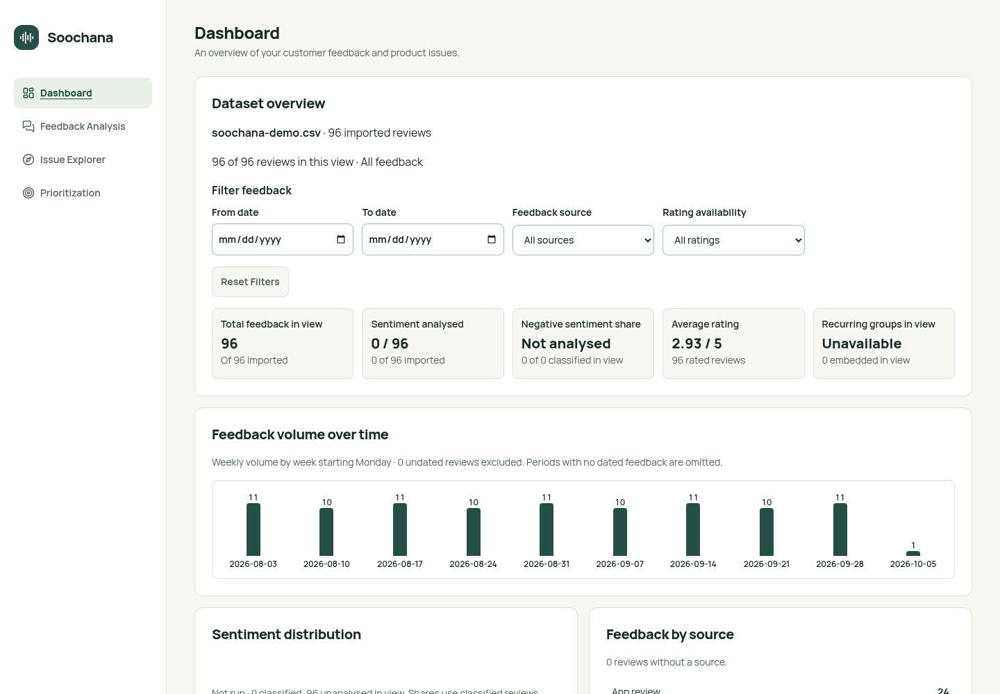

# Soochana

**Turn customer feedback into clear product decisions.**

Soochana is a customer feedback intelligence workspace for product managers, product and business analysts, customer experience and operations teams, and founders. Reviews and support tickets often arrive in separate tools and describe the same problem in different words. Soochana aims to bring that feedback together and help teams decide what to investigate, with links back to the original evidence.

Soochana means a clue, indication, or signal. Earlier milestone reports use the former name, VoiceLoop.

## Portfolio demo

Start Soochana locally, select **Try Demo Dataset**, and confirm the import of 96 synthetic shop reviews. Explore feedback by source and date, and inspect category and rating in the original reviews. Run browser-based sentiment and semantic grouping when model downloads are available, then rank a manual or discovered issue using review evidence and your own assessments.



- [Step-by-step demo](docs/demo/walkthrough.md) · [Empty dashboard](docs/demo/screenshots/dashboard-empty.png) · [Synthetic CSV](public/demo/soochana-demo.csv) · [Vercel release plan and checklist](docs/demo/release-checklist.md)
- [Milestone 7 QA and evaluation](docs/qa/milestone-7-report.md)

Use Node.js 24 and run:

```sh
npm ci
npm run dev
```

Open [localhost:3000](http://localhost:3000). For production-style demo verification, run `npm run build` and `npm start`, then use `SOOCHANA_CHROMIUM=/path/to/chromium npm run qa:demo` in a second terminal. Set `SOOCHANA_URL` for a different local port and `SOOCHANA_SCREENSHOTS` to save screenshots.

CSV processing and inference run in the browser. Session data clears on refresh. First-time inference requires network access to the model and WASM hosts. The manual demo requires neither model. Deployment approval is pending.

## Implementation history

## Milestone 1

The workspace includes a responsive Dashboard, Feedback Analysis, Issue Explorer, and Prioritization. The dashboard displays empty states for four metrics and links to the feedback page. Issue Explorer and Prioritization explain their planned functionality.

The app uses Next.js App Router, React, TypeScript, Tailwind CSS, Lucide, Papa Parse, and locally bundled Manrope and Newsreader fonts. ESLint, Vitest, jsdom, and React Testing Library verify the code and UI.

## Milestone 2

Open **Feedback Analysis**, browse for or drop a CSV, review the detected column mappings, inspect the quality report, and search, sort, or page through accepted feedback. Confirm the import to keep the dataset in memory. The summary lets you reopen the preview or confirm a removal or replacement.

### CSV format

Use UTF-8 with or without a BOM, a header row, and one feedback entry per data record. Comma, semicolon, and tab delimiters are detected automatically. Quoted fields can contain delimiters, escaped quotes, and line breaks. Both LF and CRLF line endings are supported.

| Field | Example headers | Accepted values |
| --- | --- | --- |
| Feedback text (required) | review, review_text, feedback, feedback_text, text, comment, message, ticket_description, description | Nonblank text, up to 10,000 UTF-16 code units before trimming |
| Date | date, created_at, timestamp, submitted_at | Valid calendar date in YYYY-MM-DD format |
| Source | source, channel, platform | Free text |
| Rating | rating, stars, score | Decimal number from 1 to 5, inclusive |
| Category | category, topic, issue_type | Free text |

Matching ignores case and treats spaces and hyphens in headers like underscores. Ambiguous headers require manual selection. Each source column can map to one field.

### Limits and validation

- MVP limits are 5 MiB per file, 10,000 data records, and 200 columns. Files over these limits are rejected. Malformed quoting and invalid UTF-8 also reject the file.
- Each accepted row keeps its original feedback, trimmed display text, stable ID within the dataset, and logical CSV record number. The header is record 1 and a multiline quoted record counts as one row.
- Blank feedback, feedback over the length limit, and mismatched field counts exclude a record. Blank data records count as missing feedback. The quality report shows one exclusion reason per row.
- Duplicates use trimmed, case-insensitive feedback text with consecutive whitespace collapsed. The first eligible row wins, even when a later copy has different metadata. Similar wording remains separate. Duplicate and missing counts are subsets of rejected records.
- Invalid dates or ratings on accepted rows produce warnings and are stored as missing. Blank optional values remain missing. Date-time strings, localized dates, and ratings outside the supported range require cleanup in the CSV source.

### Session and privacy

CSV content is read, parsed, and previewed in the browser. The app keeps confirmed records in React memory across in-app navigation. A refresh or tab close clears them. This workflow has no upload endpoint, persistent browser storage, analytics tracking, or server-side processing. Milestone 3 also runs inference locally. See the model download details below.

Import and preview handle one dataset at a time. CSV parsing and row validation run on the browser’s main thread for both local uploads and the demo dataset. The model workers handle sentiment and embedding inference. Persistent storage, exports and deployment remain future work.

### Try a CSV import

Save the following synthetic content to a local file named `test-feedback.csv`.

```csv
review,date,source,rating
"The app crashes during payment",2026-11-01,App Store,1
"Delivery was quick and easy",2026-11-02,Play Store,5
"Payment fails every time",2026-11-03,Support,2
```

Run the app and open **Feedback Analysis → Browse CSV**. Verify that Feedback text, Date, Source, and Rating are mapped. Select **Review quality** and check for three accepted records and zero rejections. Select **Preview accepted records** and search for `payment` to see two matches. Clear the search and sort by rating. Select **Continue to confirmation → Import 3 feedback records**, then **View imported feedback**.

## Milestone 3

After confirming a dataset in **Feedback Analysis**, choose a scope and select **Analyse Sentiment**. The default is the first 100 accepted records in CSV order, or the whole dataset when it has fewer. The panel shows progress, failures, unanalysed records, sentiment totals for the analysed subset, and searchable review-level predictions. The configurable confidence threshold flags results for manual inspection. Confidence is the model's assigned score. Empirical accuracy is measured separately.

### Model and browser privacy

Soochana runs [Xenova/twitter-roberta-base-sentiment-latest](https://huggingface.co/Xenova/twitter-roberta-base-sentiment-latest) at revision `f3ec4d0925f90c3ca7ee7814f52d6ee7cf180445`, using Transformers.js 4.3.2 and ONNX Runtime WASM in a dedicated module Web Worker. This is Xenova's quantized ONNX conversion of [Twitter-roBERTa-base for Sentiment Analysis](https://huggingface.co/cardiffnlp/twitter-roberta-base-sentiment-latest) by CardiffNLP, whose model card specifies [CC BY 4.0](https://creativecommons.org/licenses/by/4.0/). The conversion card links the original and lists no separate license. Transformers.js is [Apache-2.0](https://github.com/huggingface/transformers.js/blob/main/LICENSE).

Model indices are **0 Negative, 1 Neutral, 2 Positive**. The quantized model file is 125,905,426 bytes (120.1 MiB), plus tokenizer, configuration and WASM assets. Use a current browser with Web Workers and WebAssembly, available memory, and internet access for the initial download. Model files come from Hugging Face and runtime files come from jsDelivr. Cache Storage can retain model and runtime assets where available, subject to browser limits and eviction. **The browser downloads model files. Customer feedback is analysed locally and is never uploaded for inference.** Reviews and predictions are held only in session memory.

The worker processes one review at a time. A completed run can reuse its loaded model. Cancel terminates the worker and labels any results already received as partial. Restarting creates a new run and may reload assets. Replacing or removing the dataset cancels analysis and clears its predictions. Navigation retains the current session. Refreshing clears it.

The model was trained on English tweets and fine-tuned on TweetEval. Product feedback is a different domain. Sarcasm, negation, mixed opinions, short reports, and other languages can mislead the classifier. Long inputs are truncated by the tokenizer while the full review remains available in the UI.

### Synthetic evaluation

The [fixture](evaluation/sentiment-fixture.json) contains 36 synthetic English reviews, 12 per class. The implementing assistant assigned reference labels before inference. The examples received no independent human annotation or adjudication. This is an exploratory baseline.

Chromium ran the real pinned model in WASM. Accuracy was **83.3% (30/36)** and macro F1 was **0.834**. The confusion matrix uses reference labels as rows and predicted labels as columns in Negative, Neutral, Positive order. Its rows are `[9, 3, 0]`, `[0, 12, 0]`, and `[1, 2, 9]`. Misses included implicit complaints about late delivery and battery drain, praise phrased as the end of an earlier problem, and a review that contrasted expected difficulty with quick setup.

The cloud Chromium build rejected the model host's TLS certificate. During verification, the test harness streamed the real pinned model and runtime artifacts fetched by the workspace's trusted HTTPS client. The application worker and inference code were unchanged. Normal browser runs fetch the assets directly.

To reproduce, build and start with `npm run build` and `npm start`. Run `SOOCHANA_CHROMIUM=/path/to/chromium npm run evaluate:sentiment` with a current Chrome or Chromium executable. Set `SOOCHANA_URL` if the app uses a different address. The script imports the fixture through the app and prints real browser predictions, per-class metrics, the confusion matrix, and the five smoke cases.

## Milestone 4

Import and confirm a CSV in **Feedback Analysis**, then open **Issue Explorer** and select **Discover Feedback Groups**. Discovery uses the first 100 accepted CSV records by default, with a smaller selectable scope. Click **View evidence** to inspect original review text, source, date, rating, CSV row, available sentiment prediction, and cosine similarity to the representative review. Search or filter groups and open **Ungrouped feedback** to inspect singletons.

### Model and privacy

The app uses [Xenova/all-MiniLM-L6-v2](https://huggingface.co/Xenova/all-MiniLM-L6-v2/tree/751bff37182d3f1213fa05d7196b954e230abad9) at revision `751bff37182d3f1213fa05d7196b954e230abad9`, based on [sentence-transformers/all-MiniLM-L6-v2](https://huggingface.co/sentence-transformers/all-MiniLM-L6-v2). Both cards list Apache-2.0. Transformers.js 4.3.2 runs the q8 ONNX model in a single-threaded WASM worker. The weight file is 22,972,370 bytes (21.9 MiB) plus tokenizer and runtime files. The converted tokenizer truncates at 512 tokens. The original Sentence Transformers configuration used a 256-wordpiece default, and its training used shorter sequences. Inference uses attention-mask mean pooling and L2 normalization, validated against 384 finite float32 components and a unit norm.

Hugging Face and jsDelivr supply model and runtime assets. Cache Storage can reuse the downloaded assets. Feedback, embeddings, and predictions stay in memory, and review text is processed locally. The app runs only one model at a time. Discovery releases an idle sentiment worker and retains its predictions. A discovery worker exits after each run. Cancellation retains valid partial embeddings. Dataset replacement, removal, or refresh clears associated results. Navigation preserves the dataset, results, and cutoff for the session.

### Grouping method

Complete-link clustering starts with one review per cluster. It repeatedly joins the pair of clusters with the highest minimum cross-cluster cosine similarity, provided that minimum meets the cutoff. Stable record IDs break ties. Recurring groups have at least two reviews, and singletons remain inspectable. Group IDs derive from sorted member IDs. Cohesion is the mean cosine similarity of all unordered within-group pairs. The representative has the highest mean similarity to the other members, with stable ID tie-breaking. Suggested headings use an excerpt from that review.

The exploratory cutoff ranges from **0.60 to 0.90** in 0.05 steps and defaults to **0.75**. The app recalculates groups from the same in-memory similarity matrix. Higher cutoffs tend to create fewer or smaller groups with more singletons and false splits. Lower cutoffs can reduce false splits while increasing false merges. Cosine similarity is a geometric score. A group is marked as a potential issue only when more than half of all members have Negative sentiment predictions. Other groups remain visible, and the UI reports sentiment coverage. Review the evidence before treating any theme as a complaint.

With `n ≤ 100` and `d = 384`, pairwise scores take O(n²d) time and O(n²) space, and complete-link selection takes O(n³) time with the bounded matrix. Only embedding inference runs in a worker. The matrix is computed once when the run stops. The cutoff and labels are heuristics. Negation, mixed intent, and domain vocabulary can produce false merges or splits. The model targets English and group coverage is limited to the selected sample.

### Evaluation

The [48-example synthetic fixture](evaluation/issues-fixture.json) uses seven author-assigned topics of six reviews each plus six distinct outliers. Labels and cutoff were set before inference and have no independent human review. Pairwise precision is the share of predicted pairs with the same reference topic, and recall is the share of reference pairs grouped together. Ungrouped reviews have no predicted partners, and each reference outlier has its own topic.

At cutoff 0.75, Chromium produced **3 recurring groups and 42 ungrouped reviews**. Pairwise precision was **0.667**, recall **0.019**, and F1 **0.037** (2 correct pairs, 1 false merge, 103 false splits). The false merge paired a slow delivery with praise phrased as “not slow at all.” All three specified same-topic smoke pairs scored higher than both unrelated comparisons, but all fell below the default cutoff. The default is conservative on this fixture, with very low recall.

After `npm run build` and `npm start`, run `SOOCHANA_CHROMIUM=/path/to/chromium npm run evaluate:issues`. Set `SOOCHANA_URL` for a different address. The runner uses the real application worker and prints measured similarities, pairwise metrics, and each false merge and split.

Real Chromium inference and the issue workflow were verified with checksum-matched MiniLM weights fetched over trusted HTTPS and streamed by the test harness. At Milestone 4, the default cloud Chromium profile rejected the model host’s TLS certificate, so direct cold downloads were unverified and the milestone remained partial. Browser coverage was limited to Chromium. Milestone 3 retains its earlier partial status and its assistant-labelled synthetic sentiment evaluation. Later cold-start results are recorded in the [release checklist](docs/demo/release-checklist.md#local-cold-start-evidence).

## Milestone 4.1

The Milestone 4 baseline above remains historical. The production default is still **complete-link at 0.75**. The Issue Explorer now identifies the active method and cutoff, offers **average-link (exploratory)** in Advanced grouping settings, and flags groups with both Positive and Negative predictions for manual review. The warning uses available sentiment only and leaves cluster membership unchanged. Evidence still traces to the original CSV rows. Switching methods or thresholds reuses the current matrix, and replacement or removal resets those settings.

### Why recall was low

The embedding configuration remains the pinned MiniLM q8 model documented above. The worker uses the model's 512-token converted tokenizer, attention-mask mean pooling, and finite, L2-normalized 384-dimensional vectors. Development and holdout examples were at most 72 characters, so model input truncation does not explain these results. The development same-topic cosine quartiles were **0.423 / 0.510 / 0.587**, versus **0.111 / 0.204 / 0.304** for different-topic pairs. The distributions still overlap. A different-topic pair reached **0.827** and the maximum same-topic score was **0.778**. The 0.75 cutoff excludes most paraphrases, and complete-link requires every pair to cross it.

The historical false merge paired delayed delivery with “not slow at all” at cosine **0.763**. Shared vocabulary can dominate polarity. Lower cutoffs also admitted cross-topic pairs, so thresholds alone cannot reliably separate product issues. In the browser replay, sentiment classified that pair as Neutral and Positive, so the mixed-sentiment warning did not fire. The warning requires both a positive and a negative prediction and can miss contradictions when sentiment is absent or wrong.

### Candidates and holdout

The original 48 examples plus nine new examples form the **57-review development set**. The **46-review holdout** was separately written and labelled before embeddings were inspected. Labels are synthetic and assistant-assigned. The comparison swept complete-link, average-link, normalized centroid-link, and reciprocal nearest neighbors from 0.40 to 0.85 in 0.05 steps. None met the predeclared 0.80 development precision floor. The best development F1 came from average-link at 0.45. It remains opt-in because of false merges. The default and exploratory settings were fixed before the holdout run.

| Fixture and setting | Precision | Recall | F1 | TP / FP / FN | Groups / singletons |
| --- | ---: | ---: | ---: | ---: | ---: |
| Original · complete-link 0.75 | 0.667 | 0.019 | 0.037 | 2 / 1 / 103 | 3 / 42 |
| Original · average-link 0.45 | 0.677 | 0.619 | 0.647 | 65 / 31 / 40 | 8 / 7 |
| Development · complete-link 0.75 | 0.667 | 0.018 | 0.035 | 2 / 1 / 109 | 3 / 51 |
| Development · average-link 0.45 | 0.571 | 0.577 | 0.574 | 64 / 48 / 47 | 10 / 8 |
| Holdout · complete-link 0.75 | 0.000 | 0.000 | 0.000 | 0 / 0 / 54 | 0 / 46 |
| Holdout · average-link 0.45 | 0.431 | 0.463 | 0.446 | 25 / 33 / 29 | 10 / 11 |

See the [full 40-configuration comparison](evaluation/issues-4.1-report.md) for group sizes, cohesion, timings, and machine-readable false-pair evidence. The browser coverage and cloud TLS caveats from Milestones 3 and 4 still apply. The real worker ran with checksum-verified assets staged for the test. The synthetic holdout does not establish production grouping quality.

With the production app running and `SOOCHANA_CHROMIUM` set to a Chrome or Chromium executable, reproduce with:

```bash
npm run evaluate:issues -- baseline average-link-v1 0.45
npm run evaluate:issues -- development
npm run evaluate:issues -- holdout average-link-v1 0.45
```

## Milestone 5

After confirming a CSV, open **Dashboard** for feedback volume, source and rating distributions, sentiment by source, recurring feedback themes, and original review evidence. The dashboard displays imported metadata immediately. Sentiment and grouping sections update when their respective analyses are started from Feedback Analysis and Issue Explorer. Visiting Dashboard starts neither model.

### Filters and denominators

Use inclusive date bounds, exact source names (including missing source), rating availability, and an available sentiment class. **Reset Filters** restores the imported view. All charts, coverage, and evidence use the same filtered records. Date filters exclude undated rows. A sentiment filter excludes unanalysed rows and reports how many were excluded after applying the other filters. Filters and evidence selections reset when the dataset changes. Dashboard filters also reset when you leave the route.

- **Feedback** reports matching reviews and the full accepted CSV count. **Sentiment analysed** reports real predictions in the view and full-dataset coverage. **Negative share** divides Negative predictions by classified reviews in the view. Sentiment by source uses that source's classified denominator and shows its coverage over matching imported rows. A source with fewer than ten predictions is marked as a small sample.
- **Average rating** uses valid numeric ratings from 1 to 5. The distribution uses half-open intervals [1,2), [2,3), [3,4), [4,5), and a separate exact-5 bucket. Decimal values are preserved in review evidence. Missing ratings are excluded from the average and counted separately.
- **Source distribution** preserves trimmed names as imported, including case. The eight most frequent named sources are shown individually. Other named sources share a bucket, and missing sources remain separate. Large source lists use exact text entry rather than rendering thousands of options.
- **Volume over time** uses UTC calendar dates from the CSV, with no time-zone shifts. Dated spans up to 30 days are shown daily, up to 180 days weekly (Monday start), and up to 1,825 days monthly. Longer spans use calendar years or bounded multi-year buckets. Empty periods are omitted and undated reviews are counted separately.
- **Recurring themes** use the shared Issue Explorer result at its current method and cutoff. Filtered group counts include existing groups with at least one matching member. The dashboard never reclusters the filtered view. The group summary distinguishes embedded, grouped, and ungrouped records within the view and displays embedding scope and run status. Groups are exploratory and zero detected groups can coexist with recurring issues.

### Evidence and coverage

Activate a chart bar by pointer or keyboard to open its underlying reviews, with original text and CSV row, source, date, rating, and available sentiment. A drilldown leaves global filters in place. The table shows 20 rows per page. Partial and cancelled runs expose the valid results received so far. Group and sentiment model coverage can differ, and both retain their existing 100-review analysis cap.

The dashboard uses pure client-side selectors and native HTML buttons with CSS bars. There are no new dependencies or chart services. Filtering and metadata aggregation are bounded by imported records, and the dashboard and Issue Explorer share a memoized grouping result. Customer feedback remains in session memory. Refresh clears it. The model quality and cold-download limitations documented above still apply.

## Milestone 6

Open **Prioritization** after importing feedback. Create a manual issue by naming it and selecting supporting reviews in the searchable, paginated picker. Manual issues work without sentiment or grouping. To use a discovered theme, choose **Add Discovered Group**, inspect the original evidence, and save the draft. The queue reports distinct supporting reviews once even when a review supports several candidates. Reviews are units of evidence, and the dataset has no customer identity.

Discovered candidates retain the member IDs, representative CSV row, grouping method and cutoff, and the embedded population at selection time. If the current grouping changes or disappears, the candidate keeps its saved evidence and shows a stale-snapshot warning. **Review grouping snapshot** lets you choose a current group and inspect it in a draft before explicitly saving replacement evidence. Existing assessments remain editable. Discovered groups are unverified automatic suggestions.

### Evidence and assessments

Evidence frequency counts distinct selected review IDs. Manual share uses the imported dataset. Discovered share uses the saved embedded population and shows overall import coverage. Manual curation may be incomplete, and both evidence selection methods can bias cross-type ranking. Filter by candidate type to examine a single provenance. Negative share uses only available sentiment predictions among the supporting reviews, and average rating uses only valid ratings. The detail view lists sources, ratings, dates, original CSV rows, and latest dated feedback. The optional trend compares two 28-day windows anchored to the latest imported date. It requires an imported date span covering both windows and at least four dated supporting reviews with evidence in each window.

Severity, business impact, and evidence confidence are separate reviewer-entered 1–5 judgments. Business impact is an ordinal assessment. Evidence confidence concerns whether the chosen reviews support the issue. A reviewer can also record status and rationale. “Validated by reviewer” records a human decision about the evidence.

### Scoring and sensitivity

- Frequency is `100 × min(unique evidence count / 20, 1)`. Twenty supporting reviews is the fixed benchmark, independent of dataset size or candidate type.
- Assessments normalize with `25 × (rating − 1)`, so the minimum assessment contributes zero and the maximum contributes the full factor weight.
- The priority score is the sum of normalized factors multiplied by weight fractions. Defaults are **30% frequency, 30% severity, 25% business impact, 15% evidence confidence**. The queue hides updated scores until all weights are finite, nonnegative, and total 100%. Candidates with missing assessments or evidence remain visible as unscored.
- Rank sorts by full-precision score, then evidence count, then stable candidate ID. Table filters and alternate sorts preserve the full-queue rank. The sensitivity table compares default and active scores and ranks, and identifies the largest absolute contribution change. These scenarios show how assumptions change the ordering.

The deterministic scoring fixture gives Checkout **46.75** and Billing **45.25** under defaults. At 100% business impact the scores become **25.00** and **100.00**, reversing the ranks. The fixture includes shared and duplicate reviews, incomplete assessments, and missing model and metadata fields. Tests verify the intermediate contributions, score bounds, tie-breaks, and draft lifecycle.

Reviews, saved candidates, drafts, and weights live only in browser memory. Navigation keeps the active dataset's drafts and settings. Refresh, closing the tab, or confirming dataset removal or replacement clears them. Prioritization starts neither model and has no new dependencies or external services. The historical model quality, selection bias, and cloud TLS limitations still apply.

## Milestone 7

The release-readiness audit covers regression tests, browser accessibility, privacy, performance, and model evaluation. See the [QA report](docs/qa/milestone-7-report.md) for results and reproduction commands.

## Local setup

Use Node.js 22.13 or later in the 22.x line, or Node.js 24 or later, and npm.

```bash
git clone --recurse-submodules https://github.com/harisankar-work/soochana.git
cd soochana
git submodule update --init --recursive
npm ci
npm run dev
```

When the optional ONNX Runtime Node GPU download is blocked, use `ONNXRUNTIME_NODE_INSTALL=skip npm ci`. Soochana uses the browser WASM runtime.

For an existing checkout, start with the submodule command from the project root. Open [Soochana locally](http://localhost:3000).

```bash
npm run typecheck
npm run lint
npm run test
npm run build
npm start
```

## Design system

The [Apple Design Skill](https://github.com/dickwu/apple-design-skill) is pinned as a Git submodule at `.design-rules`. The app adapts its guidance for a browser-based workspace.

- **Layout and typography** use consistent card spacing, a readable type hierarchy, and grids that adapt to narrow viewports.
- **Accessibility and color** use semantic landmarks, a skip link, visible focus indicators, labelled icons where needed, and a text underline alongside the active navigation color.
- **Sidebars and buttons** inform the desktop sidebar, the compact grid of links on mobile, and the single prominent dashboard action. Navigation links and the primary action have 44 CSS pixel minimum heights.
- **Writing and feedback** inform explicit empty states, inline CSV errors with recovery steps, and file status near the upload controls. The import provides a browse button alongside drag and drop, labelled mapping controls, and a horizontally scrollable preview table.

## Roadmap

| Milestone | Planned work |
| --- | --- |
| 2 | Implemented CSV import, column mapping, row validation, duplicate detection, and searchable preview |
| 3 | Implemented browser-based, pretrained sentiment classification with Transformers.js |
| 4 | Implemented browser-based MiniLM grouping and review evidence |
| 5 | Implemented filtered dashboard analytics, model coverage, and review evidence |
| 6 | Implemented evidence-backed prioritization, reviewer assessments, and weight sensitivity |
| 7 | Audited release readiness. Direct cold model downloads remain blocked in the test environment. |
| 8 | Prepared the portfolio demo and release plan. Deployment requires separate approval. |

Future exports will let teams share reports with supporting evidence.

## License

Soochana application code is available under the [MIT License](LICENSE). The design reference retains its upstream terms.
