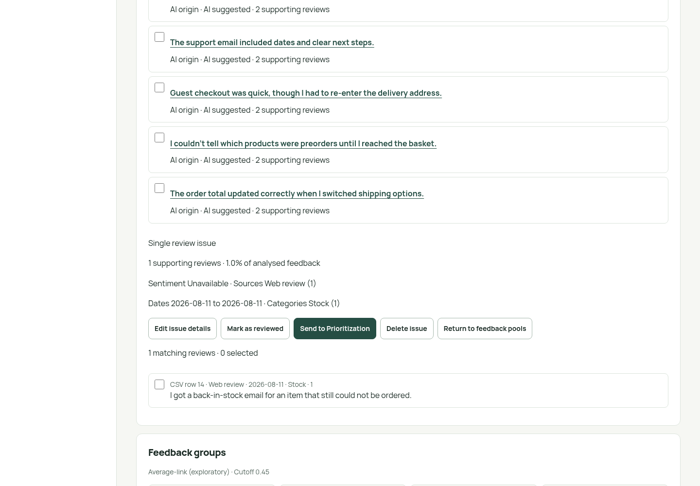
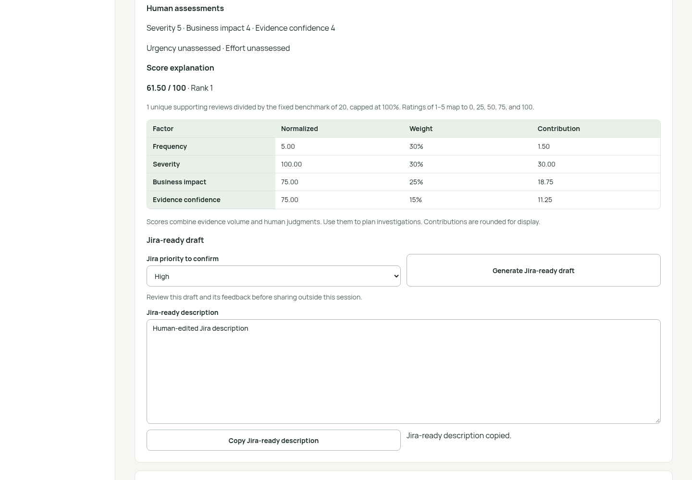

# From feedback to a Jira draft

1. Select **Explore completed demo** to open a prepared 100-review marketplace workspace on any entry page. To import it through the normal confirmation flow instead, select **Try Demo Dataset** and keep automatic analysis enabled. Sentiment runs first, then issue discovery.
2. Open **Issue Explorer**. The marketplace uses the validated exploratory 0.45 average-link setting. Treat these groups as proposals and review the evidence.

3. Open an issue in **Manage issues**. Use **Edit issue details** to write a problem statement, inspect the supporting records, and mark the issue reviewed. Select several issue checkboxes to merge them under a new title. Selecting individual source reviews exposes split, move, unassign, and exclude actions. The **Feedback pool** selector distinguishes pending, analysed and unassigned, suggested, assigned, and excluded records. Deleted evidence returns to the pool. **Undo issue change** restores a previous organization state.
4. Select **Send to Prioritization** on the issue. The same issue opens in the ranked queue. Add severity, business impact, and evidence confidence. Optional urgency and effort are reviewer-entered metadata and do not change the default score. Evidence changes retain judgments and pause the score until you explicitly reconfirm. A problem statement without evidence is valid and remains unscored.
5. Generate a Jira-ready draft under the issue details. Choose a priority if you want to confirm it, then edit the text before copying. Download the prioritized issue CSV and evidence and assessments CSV to keep your work. Soochana does not contact Jira. Review the exported feedback before sharing it.

Refreshing, closing the tab, removing a dataset, or replacing it clears associated session work. A first import keeps manually recorded problem statements that had no dataset evidence. Use the export actions before replacing a dataset.

[Milestone 10 portfolio walkthrough](walkthrough.md) · [Grouping evaluation](../../evaluation/reports/milestone-11-grouping.md)

