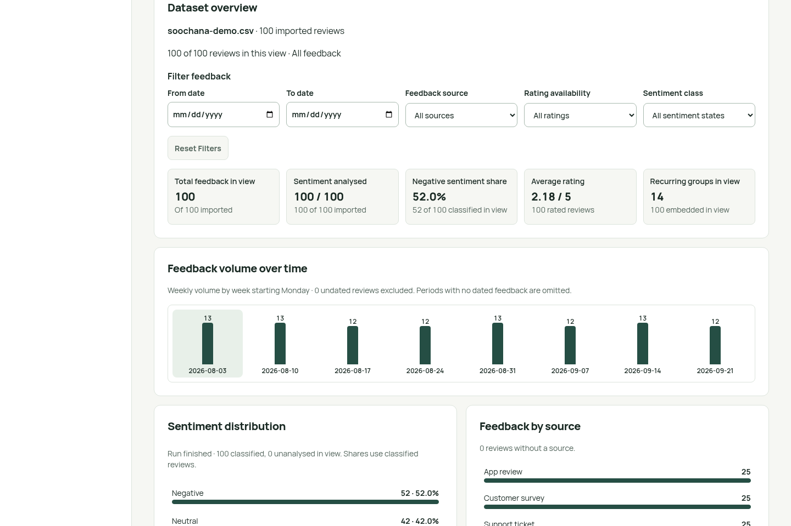
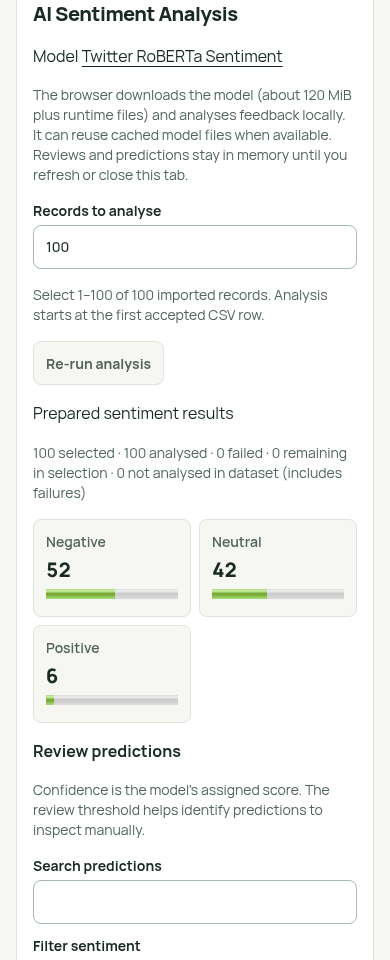
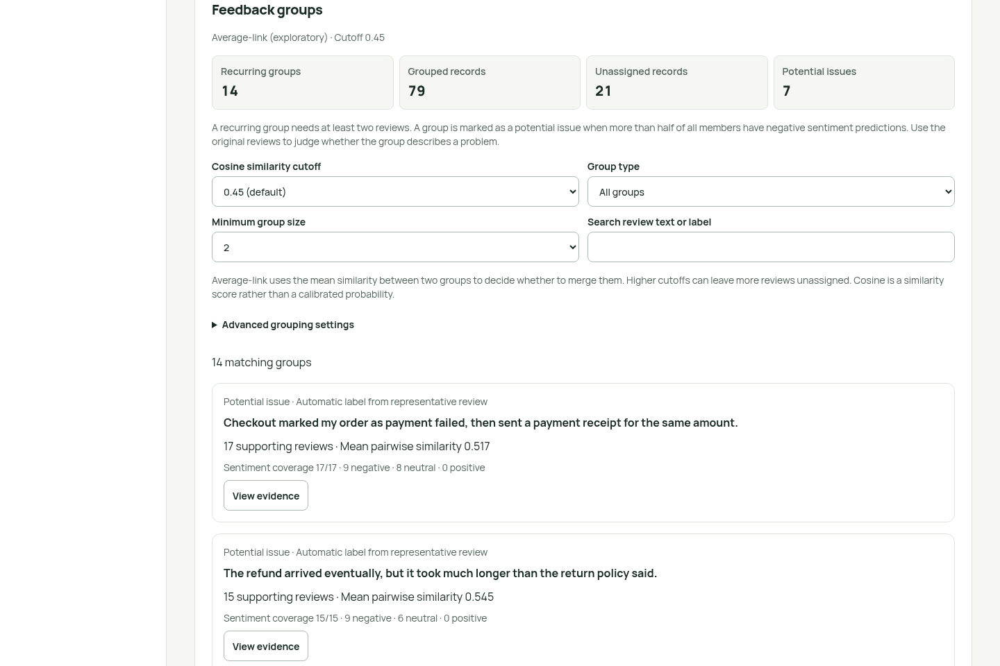
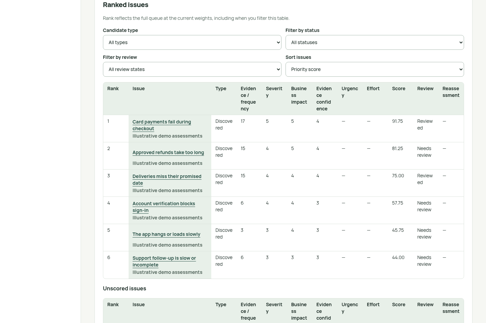

# Soochana marketplace demo

Soochana's demo follows 100 fictional customers using one marketplace. It includes reviews, support tickets, surveys, and website feedback across checkout, delivery, returns, account, and other product areas.

1. On **Dashboard**, select **Explore completed demo**. All four pages share the workspace. The prepared banner identifies the model results and illustrative business assumptions. The browser fetches the demo assets from Soochana. It downloads no model weights.
2. On **Dashboard**, look for 100 reviews, a 2.18/5 average, and 25 reviews per source. Filters operate on the actual imported reviews. **Feedback Analysis** shows the imported rows and all three predicted sentiment classes.
3. In **Issue Explorer**, review the suggested issues and inspect their original supporting reviews. Use the feedback pools to access unassigned reviews. Open an issue to edit, mark reviewed, split, or move evidence. Use the issue checkboxes to merge two related issues. Changes flow into Prioritization immediately.
4. In **Prioritization**, compare the scored examples and unscored suggestions. The example business judgments are illustrative. Each score can be recalculated using the displayed formula and weights. Changing evidence puts scored issues back into reassessment until judgments are reconfirmed.
5. Open an issue to generate and edit a Jira-ready draft. Copy the text or download the prioritized issues and evidence as CSV. Review original feedback before sharing an export.

Select **Run live analysis** in the prepared banner for a genuine browser rerun. Sentiment runs first, then issue discovery. The banner shows download and processing progress, and the same issue organization survives the rerun. You can also use **Try Demo Dataset** to review mapping and confirm a live run from scratch. **Restore prepared demo** asks for confirmation before replacing current session work. Refresh clears the session.

[Demo CSV](../../public/demo/soochana-demo.csv) · [Reference labels](../../evaluation/ground-truth/marketplace-demo.json) · [Evaluation and reproducibility](../../evaluation/reports/milestone-11-marketplace-demo.md)

## Screenshots

