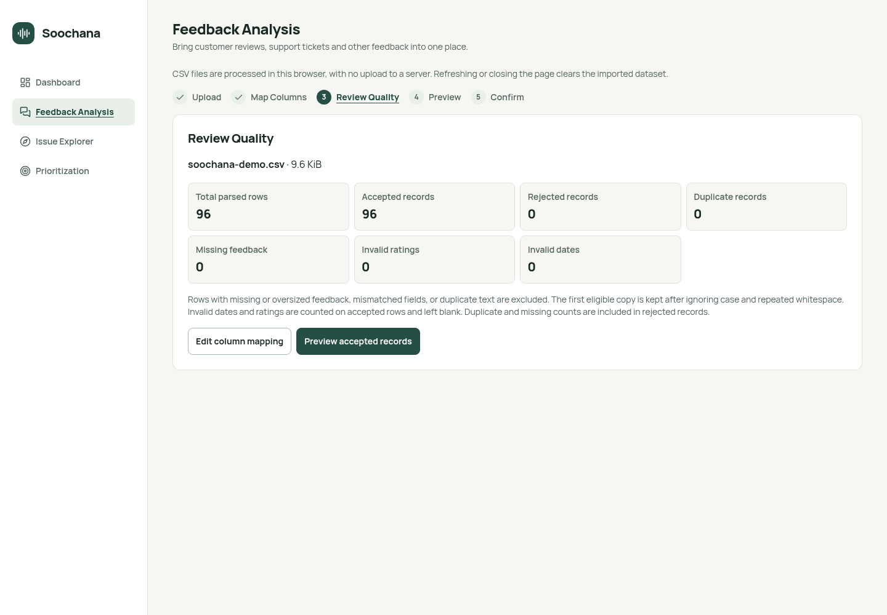
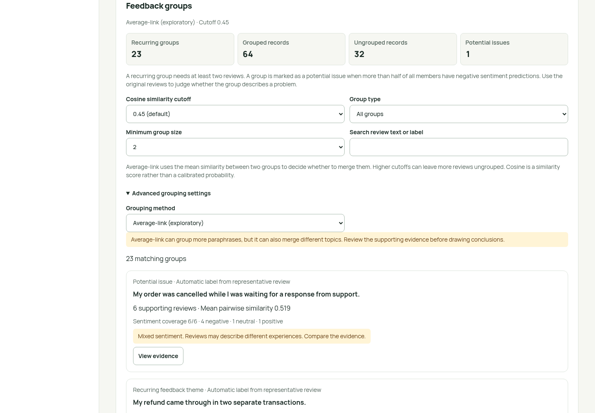
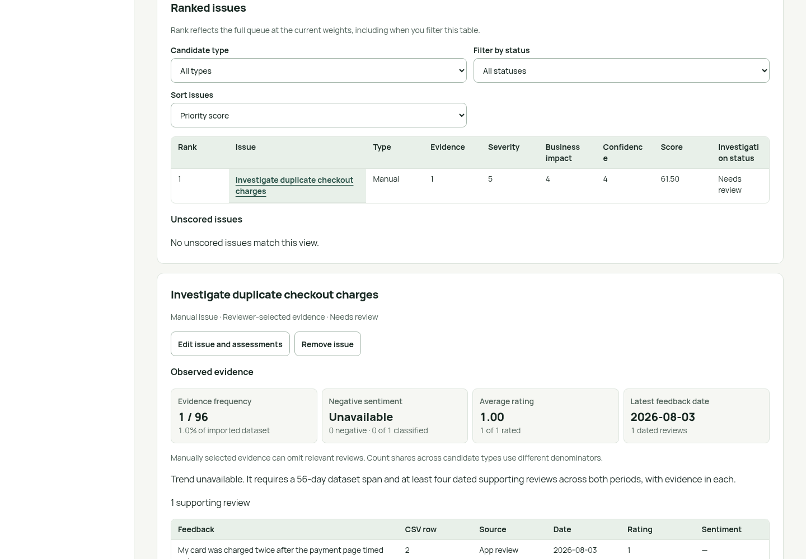

# Soochana portfolio walkthrough

You are reviewing feedback for a fictional online shop. Find an issue worth investigating and show the reviews that support it. The demo contains 96 synthetic reviews across four channels and eight categories, with dates and ratings for filtering. The same [demo CSV](../../public/demo/soochana-demo.csv) can be downloaded and imported manually.

## 1. Import and validate

1. From **Dashboard**, choose **Try Demo Dataset** to open **Feedback Analysis**, then select **Try Demo Dataset** on the import panel.
2. In **Map Columns**, verify that feedback text, date, source, rating, and category are mapped. Select **Review quality**. Expect 96 accepted rows with zero exclusions or warnings.
3. Open **Preview accepted records** and search for `charged twice`. Clear the search, choose **Continue to confirmation**, and select **Import 96 feedback records**. The import replaces an existing session only after confirmation.

## 2. Explore the evidence

1. Open **Dashboard** and confirm that it contains 96 reviews. Set **Feedback source** to **App review** and inspect the 24 matching reviews. Reset filters to return to the full dataset.
2. In **Feedback Analysis**, optionally select **Analyse Sentiment**. Then return to the dashboard and compare model coverage with the imported review count. Ratings and predicted sentiment are distinct fields.
3. In **Issue Explorer**, optionally select **Discover Feedback Groups**. The default 0.75 complete-link run left all 96 reviews ungrouped in verification. Open **Advanced grouping settings**, select **Average-link (exploratory)**, and use the 0.45 cutoff to see candidate groups. Open **View evidence** to compare the original reviews. If the evidence is coherent, use **Add Discovered Group** in **Prioritization** to create a candidate from its snapshot.

The two model actions download pinned browser artifacts on first use. If the downloads fail, continue with the dashboard and the manual issue in step 3. Model results are suggestions that require review. [Milestone 7 evaluation](../qa/milestone-7-report.md)

## 3. Prioritize a manual issue

1. Open **Prioritization** and select **Add Manual Issue**. Enter **Investigate duplicate checkout charges**.
2. Under **Supporting feedback**, search for `charged twice` and select the matching review. Confirm the review really describes a duplicate charge.
3. Set **Severity** to 5, **Business impact** to 4, and **Evidence confidence** to 4. These are example human judgments. Save the issue. The default weights yield **61.50 / 100** for one supporting review.
4. Inspect the score and the supporting review. Try different weights totaling 100% and inspect the scenario comparison. With one scored issue the rank stays first even when the score changes.

Soochana keeps feedback, results, issues and drafts in the current browser session. Refreshing clears that session. Browser caches can retain downloaded model artifacts.
